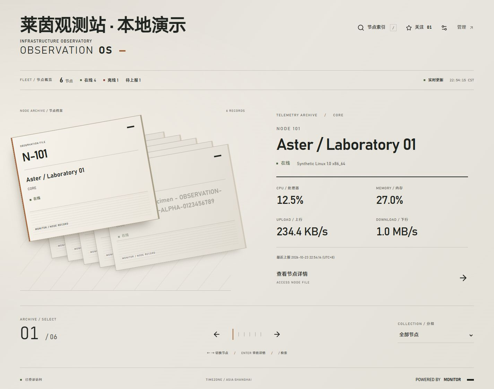

# Rhine Observation

一套面向 [Monitor](https://github.com/monitor-probe/monitor) 的纸色档案式二维主题。



## 特点

- 节点简报采用档案卡片布局，支持滚轮连续切换、键盘导航和可暂停的自动轮播。
- 节点索引支持名称搜索、分组、状态、关注筛选和排序。
- 紧凑的节点详情包含实时资源、资源趋势和网络探测。
- 多条探测曲线以实线同图叠加，支持图例显隐和共享时间缩放；保留超时、断档与服务端窗口丢包信息。
- 站点标题直接读取 Monitor 的站点名称；提供窄屏布局和减少动态效果选项。
- 使用 CSS 与 SVG 实现二维效果，无 3D 引擎、音频或远程字体。

当前兼容性基线为 **Monitor hub 1.5.0**。这是前台主题，后台管理仍使用 Monitor 自带界面。预览图和本地测试数据均为合成数据。

## 安装

1. 到 [Releases](https://github.com/krocci/monitor-theme-rhine/releases) 下载 `theme.tar.gz`。
2. 登录 Monitor 后台，在主题页面选择“上传主题包”，上传该文件。
3. 安装后选择 **Rhine Observation** 并启用。

不要选择 GitHub 自动生成的 `Source code` 压缩包。主题标识为 `rhine`，不会覆盖内置的 `default` 主题。

每个正式发布同时提供 `theme.tar.gz.sha256`。升级前保留原主题包；需要回退时，重新安装保留的版本，或在后台切回原主题即可。

主题沿用 Monitor 的登录和公开范围设置，不附带任何域名、代理或 Cloudflare Access 配置。关注节点和减少动态效果偏好保存在当前浏览器，不是服务端告警设置。

## 本地开发

使用 Node.js **24.19.0** 和仓库的 `package-lock.json`：

```sh
npm ci
```

终端一启动只监听本机的合成数据服务：

```sh
npm run mock
```

终端二启动主题：

```sh
npm run dev -- --host 127.0.0.1
```

打开 `http://127.0.0.1:5173`。默认代理指向合成服务 `http://127.0.0.1:9911`，无需真实 Monitor 数据或登录凭证。

如需连接自己的测试 hub，可设置 `MONITOR_HUB`：

```sh
MONITOR_HUB=https://monitor.example.com npm run dev
```

PowerShell 对应：

```powershell
$env:MONITOR_HUB = "https://monitor.example.com"
npm run dev
```

## 测试与打包

```sh
npm test
npm run test:tooling
npm run lint
npm run build
npm run package
npm run check:package -- --archive theme.tar.gz
```

`npm run package` 使用项目的规范打包脚本，生成含 `theme.json`、`dist/`、预览图、`LICENSE` 和 `NOTICE` 的安装包。打包检查会核对归档结构、大小限制及开发数据是否混入构建产物。

密集网络数据场景包含七条合成探测线路、一天约 2.5 万个测量点、超时、断档和尖峰。启动本地服务后可切换到该场景：

```sh
node --input-type=module -e 'await fetch("http://127.0.0.1:9911/test", {method:"POST", headers:{"Content-Type":"application/json"}, body:JSON.stringify({scenario:"dense"})})'
```

在节点详情的网络探测中选择“1 天”。将 `dense` 改为 `normal` 可恢复普通演示。数据预处理基准：

```sh
node scripts/benchmark-history.mjs
```

基准脚本测量 Node.js 中的数据处理耗时；浏览器绘制和交互流畅度仍需在目标设备上验证。

## 后续计划

价格、币种、计费周期与到期时间的可选展示计划后续加入，默认关闭、缺少数据时不显示。界面显示开关只控制主题中的展示；API 的字段和公开权限由 Monitor 管理。

## 来源与许可

本项目以 [monitor-probe/monitor-theme-default](https://github.com/monitor-probe/monitor-theme-default) `v1.4.1` 为基础，来源提交为 `4493b5f3bbfd9ef94675de0b2e11681d865a1428`，保留 stqfdyr 的 MIT 版权与许可证。

视觉方向参考 [LBEILC/RhineLabUI](https://github.com/LBEILC/RhineLabUI)。本仓库未包含其截图、标志、模型、字体、音频或其他素材，也不表示与相关项目或权利人存在隶属或授权关系。

完整许可见 [LICENSE](LICENSE)，来源说明见 [NOTICE](NOTICE)，维护者发布流程见 [RELEASING.md](RELEASING.md)。
