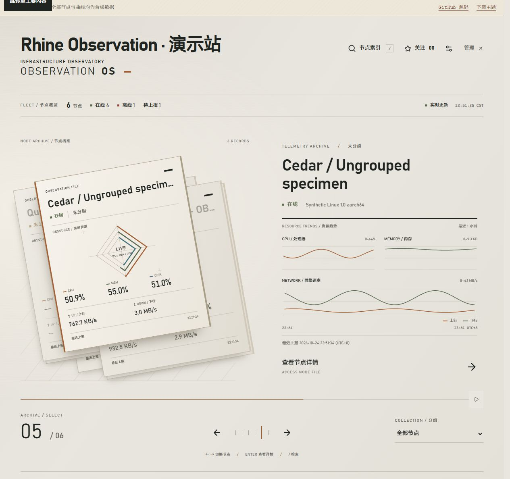

# Rhine Observation 0.1.5

日期：2026-10-24，Asia/Shanghai。

移除前台 `N-00x` 编号，避免删除节点后出现可见编号缺口。档案卡片上移名称、在线状态和分组，使用三层方环及精确数值展示 CPU、内存、磁盘；上下行速率保留在卡片底部。内部节点 ID、详情地址和关注绑定不变。

首页原大数值区改为最近一小时的 CPU、内存及上下行简略趋势，只读取当前节点；切换时取消旧请求，使用一分钟缓存并保留真实断档、孤立采样和缺测状态。

普通“节点索引”及 `/` 入口重置搜索、状态、分组和排序，关注或状态入口初始化对应筛选；从详情返回仍保留列表上下文。



## 验证

- Node.js 24.19.0；保留原依赖，锁文件仅更新两个根版本字段。
- 应用测试、24 项工具测试、lint、构建、打包及最终归档检查通过。
- 本地合成数据覆盖缺少首个节点 ID、零关注、详情往返、过期数据、离线、缺测、长名称、缓存复用及 320–1440px 布局。
- 正式构建的浏览器检查覆盖一天七线路、图例显隐、削峰、共享时间刷选拖动、390px 窄屏及主题内减少动态效果；未量化帧率。
- Monitor hub 1.5.1 生产部署通过 11 个安装文件及 6 个服务资源读回；生产浏览器显示实际资源方环、一小时趋势及普通索引恢复全部节点。
- 公开演示同步同一前端产物，9 个静态文件与本地一致；六个合成节点、七线路、24780 个一天样本和 WebSocket 正常推送/关闭检查通过。

安装包为 `theme.tar.gz`，大小 `298722` bytes：

```text
b3ab80d84daba6649fc4cae12372ef8039440d42c1b4c7f7866c3ae294d35afe  theme.tar.gz
```

旧版标签与资产保持不变。升级可通过 Monitor 原生后台上传安装包；回退只重新安装上一版主题或切换主题，无需恢复数据库。

## 保留边界

物理手机/触控板、系统级减少动态效果、长时连接、后台唤醒及完整提示框滚动组合仍需专项验收。GitHub Actions 尚未启用，本记录中的测试为本地执行。

本次 npm audit 标记固定 Vite 开发工具存在 high 等级公告，未自动升级依赖。生产主题是静态构建，不运行 Vite 开发服务器；开发依赖的独立修复评估列入 RH-09。
